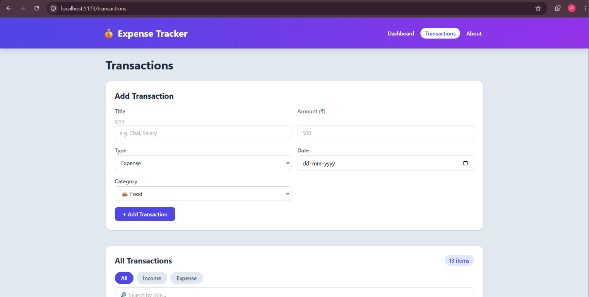
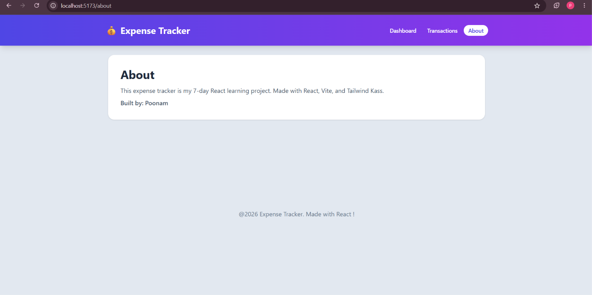

# 💰 Expense Tracker

A responsive, multi-page expense tracker built with **React**, **Vite** and **Tailwind CSS**. Users can add, edit, delete, search and filter income and expense transactions, and see their balance update automatically. Data persists in the browser using `localStorage`.

> Built as part of a 7-day, hands-on React learning challenge.

## 📸 Screenshots

| Dashboard | Transactions |
|---|---|
|   |

| Mobile | Dark Mode |
|---|---|
|  | 

## ✨ Features

- Add income and expense transactions with form validation
- Edit and delete transactions, with a cancel option while editing
- Search by title and filter by All / Income / Expense
- Dashboard with automatic balance, total income and total expense
- "High spend" badge and category badges
- Empty state when no transactions match
- Data persistence with `localStorage`
- Multi-page navigation: Dashboard, Transactions, About and a 404 page
- Dark mode that remembers your choice
- Fully responsive layout (mobile, tablet, desktop)

## 🛠️ Tech Stack

| Technology | Purpose |
|---|---|
| React | Component-based UI |
| Vite | Dev server and build tool |
| Tailwind CSS v3 | Styling and responsive design |
| React Router | Client-side routing |
| Context API | Global state management |
| localStorage | Data persistence |

## 🧠 How It Works

```
main.jsx
 └─ BrowserRouter
     └─ ThemeProvider
         └─ TransactionProvider   (state, handlers, localStorage sync)
             └─ App (Routes)
                 └─ Layout (Navbar + Outlet + Footer)
                     ├─ /              Dashboard
                     ├─ /transactions  Transactions
                     ├─ /about         About
                     └─ *              NotFound
```

- **State management:** transactions live in a Context provider and are accessed through a custom `useTransactions` hook, which avoids prop drilling.
- **Local state:** page-specific state (filters, search, edit mode) stays inside the Transactions page.
- **Derived data:** totals, balance and the filtered list are calculated during render instead of being stored separately.
- **Persistence:** `useEffect` saves transactions to `localStorage` whenever they change, and lazy state initialization loads them on startup.
- **Forms:** controlled inputs with validation, and `preventDefault` on submit.

## 📁 Project Structure

```
src/
├── components/   Navbar, Layout, SummaryCard, TransactionList, TransactionItem, ExpenseForm, Button, Card, Footer
├── context/      TransactionContext, TransactionProvider, ThemeContext, ThemeProvider
├── hooks/        useTransactions, useTheme
├── pages/        Dashboard, Transactions, About, NotFound
├── data/         Initial sample transactions
├── App.jsx
└── main.jsx
```

## 🚀 Getting Started

**Prerequisites:** Node.js 20.19+ (or 22.12+) and npm.

```bash
# Clone the repository
git clone https://github.com/[your-username]/[repo-name].git

# Go to the project folder
cd [repo-name]

# Install dependencies
npm install

# Start the development server
npm run dev
```

Open `http://localhost:5173` in your browser.

### Other scripts

```bash
npm run build     # Create a production build in /dist
npm run preview   # Preview the production build locally
```

## 📚 What I Learned

| Day | Topics |
|---|---|
| 1 | React basics, Virtual DOM, Vite and Tailwind setup |
| 2 | JSX, components, props, one-way data flow |
| 3 | `map()` and keys, conditional rendering, `filter` and `reduce` |
| 4 | Events, `useState`, immutable state updates |
| 5 | Controlled forms, `useEffect`, localStorage |
| 6 | Context API, custom hooks, React Router |
| 7 | Dark mode, responsive polish|


## 👩‍💻 Author

**POONAM**

- GitHub: [Poonam-D07](https://github.com/Poonam-D07)
- LinkedIn: https://www.linkedin.com/in/poonam-274843226/
